# PantryPal DBMS Project Report

## 1. Project Title

**PantryPal — Recipe Discovery Using Pantry Availability and Expiry-Aware Ranking**

PES University · CSE (AI & ML) · DBMS Project  
Report date: 2 November 2026

## 2. Student SRNs and Names

| Student name | SRN |
| --- | --- |
| Pranav V Menon | PES1UG24AM198 |
| Purvik V Gowda | PES1UG24AM211 |

## 3. Abstract

PantryPal helps users choose recipes using ingredients already available in their kitchen. It stores pantry purchase dates and ingredient shelf life, estimates remaining days, and recommends recipes using ingredient coverage and expiry urgency. Users can inspect their pantry, identify missing ingredients, add recipes to a meal plan and view database reports. The aim is to simplify meal selection and encourage the use of ingredients before expiry.

PostgreSQL manages nine related tables (eight business tables and one authentication-session table) and implements constraints, indexes, a view, two stored functions, a trigger and CTE-based ranking. MongoDB stores search logs and cooking journals containing arrays and nested documents. Node.js and Express connect both databases to an HTML, CSS and JavaScript interface. The ranking score gives 70 percent weight to ingredient coverage and 30 percent to urgency, while filtering vegetarian and vegan preferences. The supplied screenshots demonstrate PostgreSQL queries, application screens and MongoDB report output.

## 4. Technology Stack

| Layer | Technology | Actual use |
| --- | --- | --- |
| Page structure | HTML5 | Login/registration, signed-in identity, four tab sections, tables and buttons. |
| Styling | CSS | Grid and Flexbox layouts, responsive cards, expiry colors, progress bars and score rings. |
| Browser behavior | Plain JavaScript | Event handlers, Fetch API calls and DOM updates; no React is used. |
| Server runtime | Node.js | Runs server-side JavaScript and database drivers. |
| Web framework | Express | Serves `public/`, parses JSON, exposes GET/POST APIs. |
| Relational database | PostgreSQL with `pg` | Stores and queries users, pantry, recipes, ratings and plans. |
| Document database | MongoDB with `mongodb` | Stores search logs and cooking journals; runs aggregations. |
| Tools | VS Code, npm, psql, mongosh | Editing, dependency installation and database demonstrations. |
| Source repository | GitHub | https://github.com/pranav6126/DBMS-Project-PantryPal |

### 4.1 How the application works

```text
Browser JavaScript → Express route → PostgreSQL query/function
                  ← JSON response ← database result

Ranking request → optional MongoDB search_logs insertion
MongoDB report request → aggregation pipelines → JSON → UI tables
```

The UI starts with email/password sign-in or registration. After authentication it has **Cook tonight**, **My pantry**, **SQL reports** and **MongoDB reports** tabs. `signedInUser` holds identity returned by `/api/auth/me`; the server determines ownership from the session cookie. To compare users, sign out and sign in to the other account. The pantry form lets new users add ingredients, quantities and purchase dates.

CSS variables hold the color palette. Grid arranges recipe cards; Flexbox aligns controls. A media query changes the top card to one column on small screens. A conic gradient draws the score ring and JavaScript sets percentage widths for coverage and urgency bars.

### 4.2 ER diagram and entities

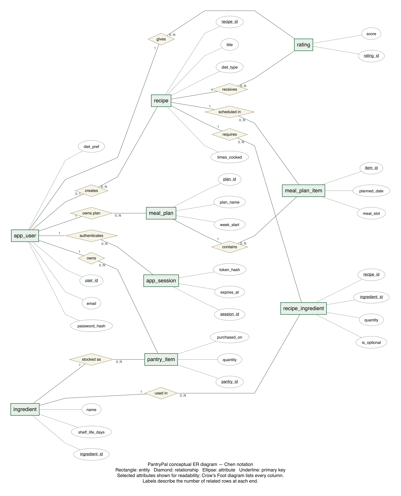

**Standard Chen notation:** rectangles represent entities, diamonds represent relationships, ovals represent selected attributes and underlined attributes form primary keys. Parent/child cardinalities and optionality are labeled.

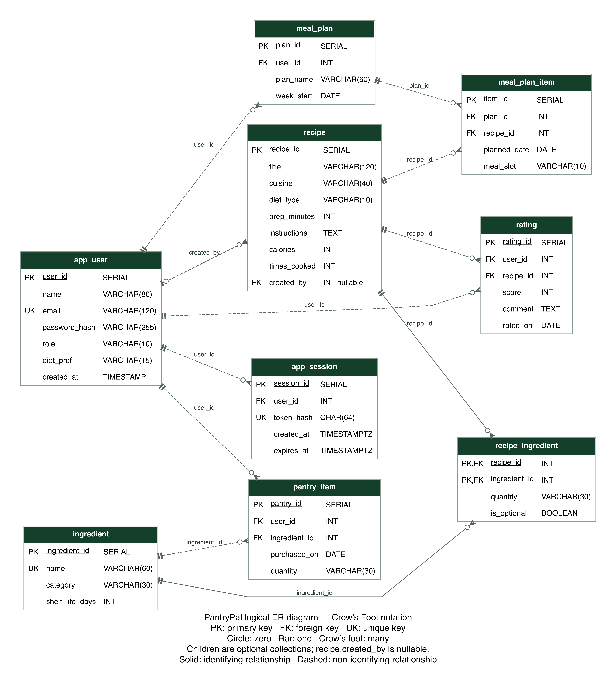

The Crow’s Foot version lists every column of all nine tables with PK/FK/UK markings, optionality and identifying/non-identifying relationships. [Open Chen SVG](PantryPal_Report_Assets/er-diagram.svg) · [Open Crow’s Foot SVG](PantryPal_Report_Assets/er-crows-foot.svg) · [Notation and migration details](docs/database-design.md). Regenerate with `npm run diagrams`.

| Table | Purpose | Key relationships or constraints |
| --- | --- | --- |
| `app_user` | User identity, role and diet preference | PK `user_id`; unique email; role/diet CHECKs. |
| `ingredient` | Ingredient catalogue, category and shelf life | PK `ingredient_id`; unique name; positive shelf life. |
| `pantry_item` | A user’s purchased ingredients and quantities | FKs to user/ingredient; unique user/ingredient pair. |
| `recipe` | Title, cuisine, diet, instructions, calories and counter | PK `recipe_id`; creator FK; positive prep time. |
| `recipe_ingredient` | Ingredients required by each recipe | Composite PK `(recipe_id, ingredient_id)`; quantity and optional flag. |
| `rating` | A user’s recipe score and comment | FKs to user/recipe; unique pair; score from 1 to 5. |
| `meal_plan` | Plan owner, name and week start | PK `plan_id`; user FK. |
| `meal_plan_item` | Individual recipe/date/slot within a plan | FKs to plan/recipe; breakfast/lunch/dinner CHECK. |
| `app_session` | Authenticated browser sessions | PK session_id; user FK; unique SHA-256 token_hash; creation and expiry timestamps. |

**PK** uniquely identifies a row; **FK** connects it to another table. One user can own many pantry entries, create many recipes, give many ratings and own many meal plans. One ingredient can appear in many pantry entries. One recipe can receive many ratings and appear in many scheduled meal entries.

`recipe_ingredient` resolves the many-to-many relationship between recipes and ingredients using two one-to-many relationships. Its composite key prevents a duplicate ingredient pair in the same recipe. `meal_plan` and `meal_plan_item` separate plan-level details from each scheduled meal. The logical diagram includes `app_user.created_at`. One user can own zero or many sessions, each belonging to exactly one user. `recipe.created_by` is nullable, so a recipe can have zero or one creator. The conceptual diagram intentionally selects attributes for readability; the logical diagram contains the complete field list.

## 5. SQL Database Commands

### 5.1 Setup and inspection

Run the following in the **normal Terminal**, from `pantrypal_code`, for a fresh database. `schema.sql` drops existing project tables; use it for initialization/reset, not during a routine presentation.

```bash
createdb pantrypal
psql -d pantrypal -f schema.sql
psql -d pantrypal -f seed.sql
# From the project root, provision local demo passwords:
# npm run setup:demo
psql -d pantrypal
```

Inside **psql**, inspect the database:

```sql
\pset pager off
\conninfo
\dt
\d pantry_item
\d recipe_ingredient
\d meal_plan_item
\dv
\df public.*
\di

SELECT user_id, name, email, role, diet_pref FROM app_user;
SELECT * FROM ingredient;
SELECT * FROM pantry_item;
SELECT * FROM recipe;
SELECT * FROM recipe_ingredient;
SELECT * FROM rating;
SELECT * FROM meal_plan;
SELECT * FROM meal_plan_item;
```

Do not enter a `psql -d ...` shell command inside psql. If the prompt is `pantrypal-#` because an unfinished command is buffered, enter `\r` to clear it. Use `\q` to return to the normal Terminal.

### 5.1a Existing installation authentication migration

From the project root, without resetting data:

```bash
psql -d pantrypal -v ON_ERROR_STOP=1 -f pantrypal_code/migrations/001_auth.sql
npm run setup:demo
```

This adds `app_session`, widens `password_hash` to VARCHAR(255), and creates case-insensitive email uniqueness. Local demo credentials are generated into ignored `DEMO_LOGIN.local.txt`. Do not publish this file. Existing scrypt hashes are not reset.

### 5.2 Database features and their use cases

The project uses **11 database features** explained below, exceeding the requested four. These are distinct mechanisms; this does not mean there are 11 stored functions. The schema defines two stored functions: `fn_rank_recipes` and the trigger function `fn_bump_times_cooked`.

| No. | Feature | PantryPal use case | Source |
| --- | --- | --- | --- |
| 1 | Trigger | Automatically updates a recipe counter after planning a meal. | `schema.sql` |
| 2 | View | Reuses the pantry expiry calculation. | `schema.sql` |
| 3 | CTEs | Separates required-ingredient and available-ingredient calculations. | `fn_rank_recipes` |
| 4 | Stored SQL function | Returns personalized ranked recipes for an input user ID. | `schema.sql` |
| 5 | Transaction | Groups the SQL meal-plan operation into a commit or rollback. | `server.js` |
| 6 | JOINs | Connects user, pantry, ingredient, recipe and rating records. | Schema, reports and API queries |
| 7 | GROUP BY and aggregates | Counts ingredients and summarizes ratings, calories and cooking data. | `reports.sql` |
| 8 | Subqueries | Finds missing ingredients and counts meals for each user. | Reports and API |
| 9 | Indexes | Provides access paths for frequent filters and joins. | SQL and MongoDB setup |
| 10 | Constraints | Prevents invalid IDs, duplicate pairs and out-of-range scores. | `schema.sql` |
| 11 | MongoDB aggregation | Summarizes searches and journal documents. | MongoDB reports and API |

#### Feature 1 — Trigger

**Use case:** Keep the recipe planning counter updated regardless of whether the insert comes from the UI or a SQL command.

```sql
CREATE OR REPLACE FUNCTION fn_bump_times_cooked()
RETURNS trigger AS $$
BEGIN
    UPDATE recipe SET times_cooked = times_cooked + 1
    WHERE recipe_id = NEW.recipe_id;
    RETURN NEW;
END;
$$ LANGUAGE plpgsql;

CREATE TRIGGER trg_meal_plan_item_insert
AFTER INSERT ON meal_plan_item
FOR EACH ROW EXECUTE FUNCTION fn_bump_times_cooked();
```

`NEW` is the inserted meal entry. Its `recipe_id` selects which recipe to update. `FOR EACH ROW` fires once per inserted row. Although named `times_cooked`, the value counts **meal-plan insertions**, not confirmed cooking. Deleting a plan entry does not decrement it in the current code.

**Demo command:** Execute inside psql. This shows an increment and then undoes the inserted row and counter change.

```sql
BEGIN;
SELECT recipe_id, title, times_cooked
FROM recipe WHERE recipe_id = (SELECT MIN(recipe_id) FROM recipe);

INSERT INTO meal_plan_item
    (plan_id, recipe_id, planned_date, meal_slot)
SELECT (SELECT MIN(plan_id) FROM meal_plan),
       (SELECT MIN(recipe_id) FROM recipe),
       CURRENT_DATE + 1, 'dinner';

SELECT recipe_id, title, times_cooked
FROM recipe WHERE recipe_id = (SELECT MIN(recipe_id) FROM recipe);
ROLLBACK;
```

The supplied screenshot shows the installed trigger definition. A screenshot of this before-and-after demonstration is still useful for final submission.

#### Feature 2 — View

**Use case:** Both recommendations and the pantry screen need the same remaining-life calculation.

```sql
CREATE OR REPLACE VIEW v_pantry_expiry AS
SELECT p.user_id, p.ingredient_id, i.name AS ingredient,
       p.purchased_on, i.shelf_life_days,
       (i.shelf_life_days - (CURRENT_DATE - p.purchased_on)) AS days_left
FROM pantry_item p
JOIN ingredient i USING (ingredient_id);
```

A normal view stores a query definition. When queried, date subtraction gives elapsed days and the view subtracts these from shelf life. A 6-day shelf life with purchase 5 days ago gives 1 day left.

```sql
SELECT * FROM v_pantry_expiry ORDER BY user_id, days_left;
```

The pantry screen displays expired items for awareness; ranking excludes rows with negative `days_left`.

#### Feature 3 — Common Table Expressions

**Use case:** Organize recipe ranking into two understandable steps before combining the results. The following is the actual CTE logic inside `fn_rank_recipes`; `p_user` is its function parameter.

```sql
WITH need AS (
    SELECT ri.recipe_id, COUNT(*) AS need_cnt
    FROM recipe_ingredient ri
    WHERE NOT ri.is_optional
    GROUP BY ri.recipe_id
),
have AS (
    SELECT ri.recipe_id,
           COUNT(*) AS have_cnt,
           AVG(GREATEST(0, LEAST(1, 1 - v.days_left / 7.0))) AS urgency
    FROM recipe_ingredient ri
    JOIN v_pantry_expiry v
      ON v.ingredient_id = ri.ingredient_id AND v.user_id = p_user
    WHERE NOT ri.is_optional AND v.days_left >= 0
    GROUP BY ri.recipe_id
)
-- Followed by the final SELECT in fn_rank_recipes.
```

`need` counts required ingredients; `have` counts valid matched ingredients and averages urgency. CTE names exist within the statement and are not permanent tables. This excerpt is not a standalone runnable command; execute the function to use it.

#### Feature 4 — Stored SQL function

**Use case:** The API needs one reusable database operation that ranks recipes for a particular user.

`fn_rank_recipes(p_user INT)` returns a table of recipe IDs, titles, matched/required counts, coverage, urgency and score. After the CTEs, its final query joins recipes, counts and the user; applies diet rules with `CASE`; and sorts by descending score.

```text
coverage = valid matched required ingredients / required ingredients
urgency  = average(clamp(1 - days_left / 7, 0, 1))
score    = 0.7 × coverage + 0.3 × urgency
```

`::numeric` avoids integer division. `GREATEST` and `LEAST` clamp urgency. `ROUND` formats returned values. The score uses the underlying values before output rounding, so recomputing it from displayed two-decimal urgency may differ slightly.

```sql
SELECT * FROM fn_rank_recipes(
  (SELECT user_id FROM app_user WHERE email = 'aarav@example.com')
) LIMIT 5;

SELECT * FROM fn_rank_recipes(
  (SELECT user_id FROM app_user WHERE email = 'meera@example.com')
) LIMIT 5;
```

The screenshots show Aarav’s Paneer Fried Rice score at **0.689** and Meera’s Masala Omelette at **0.807**. These are observed results, not fixed outputs. Optional ingredients and expired stock are ignored. Recipes need at least one valid pantry match. Vegetarian users receive veg/vegan recipes; vegan users receive vegan recipes; other preference values have no additional restriction.

#### Feature 5 — Transaction

**Use case:** Keep a meal-plan insert and its trigger counter update together when a request succeeds or fails.

The `/api/plan` route derives the user ID from the verified session and uses one borrowed PostgreSQL connection. Registration creates a default plan; the client submits only recipe_id:

```text
pool.connect → BEGIN → find first existing plan
→ read counter → INSERT tomorrow’s dinner → trigger updates counter
→ read new counter → COMMIT → client.release
On SQL failure: ROLLBACK → client.release
```

The UI sends only `recipe_id` as JSON; `req.user.user_id` supplies the owner. The route requires an existing meal plan; it does not create a new one. MongoDB logging happens separately after commit and is not part of a cross-database atomic transaction.

#### Feature 6 — JOINs

**Use case:** Display readable ingredient names and user names instead of only IDs.

```sql
SELECT u.name AS user_name, i.name AS ingredient,
       p.quantity, p.purchased_on
FROM pantry_item p
JOIN app_user u USING (user_id)
JOIN ingredient i USING (ingredient_id)
ORDER BY u.name, i.name;
```

Each join follows the stored relationship. `USING` joins equal column names; `ON` expresses a condition explicitly. `LEFT JOIN` in report R6 retains users who have no ratings.

#### Feature 7 — GROUP BY and aggregate functions

**Use case:** Summarize recipe quality by cuisine instead of listing individual ratings.

```sql
SELECT r.cuisine, COUNT(rt.rating_id) AS total_ratings,
       ROUND(AVG(rt.score), 2) AS avg_rating
FROM recipe r
JOIN rating rt ON rt.recipe_id = r.recipe_id
GROUP BY r.cuisine
ORDER BY avg_rating DESC;
```

`GROUP BY` makes one group per cuisine; `COUNT` counts ratings and `AVG` averages scores. The UI screenshot shows South Indian averaging **5** and North Indian **4.67** in that captured dataset.

#### Feature 8 — Subqueries

**Use case:** Identify required recipe ingredients absent from a user’s pantry. This is the parameterized SQL used by the missing-ingredient API.

```sql
SELECT i.name AS ingredient, ri.quantity
FROM recipe_ingredient ri
JOIN ingredient i USING (ingredient_id)
WHERE ri.recipe_id = $2 AND NOT ri.is_optional
  AND ri.ingredient_id NOT IN (
      SELECT ingredient_id FROM v_pantry_expiry
      WHERE user_id = $1 AND days_left >= 0
  )
ORDER BY i.name;
```

The `pg` driver supplies `$1` from the authenticated session and `$2` as the recipe ID. These placeholders are not ready to paste unchanged as ordinary psql SQL. The inner query returns pantry ingredient IDs; the outer query selects required ingredients outside that set. This excludes expired pantry rows, matching ranking. It still checks ingredient presence rather than sufficient quantity. Report R6 also uses a correlated subquery to count meals separately for each user without multiplying them by rating rows.

#### Feature 9 — Indexes

**Use case:** Give PostgreSQL access paths for frequent user, cuisine and relationship lookups.

```sql
CREATE INDEX idx_recipe_cuisine ON recipe(cuisine);
CREATE INDEX idx_pantry_user ON pantry_item(user_id);
CREATE INDEX idx_ri_ingredient ON recipe_ingredient(ingredient_id);
CREATE INDEX idx_mpi_plan ON meal_plan_item(plan_id);
```

These are definitions already run by `schema.sql`; use `\di` to inspect them instead of creating duplicates. The historical screenshot lists **16 indexes** before authentication. The updated schema additionally creates case-insensitive email uniqueness and the session table’s primary, unique-token, user and expiry indexes. Actual index use depends on the query planner and dataset; no speed benchmark is claimed.

MongoDB also creates compound and multikey indexes:

```javascript
db.search_logs.createIndex({ user_id: 1, searched_at: -1 });
db.search_logs.createIndex({ ingredients: 1 });
db.cooking_journal.createIndex({ recipe_id: 1 });
db.cooking_journal.createIndex({ tags: 1 });
```

#### Feature 10 — Constraints

**Use case:** Keep invalid values and duplicate relationships out of the database.

```sql
-- Excerpts from CREATE TABLE definitions, not standalone commands:
PRIMARY KEY (recipe_id, ingredient_id)
UNIQUE (user_id, ingredient_id)
CHECK (score BETWEEN 1 AND 5)
CHECK (meal_slot IN ('breakfast','lunch','dinner'))
```

Primary keys identify rows; foreign keys require valid parent records; `NOT NULL` requires values; `UNIQUE` prevents duplicates; and `CHECK` limits valid values. `ON DELETE CASCADE` removes dependent rows, `SET NULL` clears a deleted recipe creator, and `RESTRICT` prevents deleting an ingredient referenced by a recipe.

#### Feature 11 — MongoDB aggregation pipelines

**Use case:** Count ingredient occurrences inside search-log arrays and summarize journal data. Section 6 contains the pipeline code and report use cases. The aggregation screenshot shows an executed pipeline with results, not just a definition.

### 5.3 Six SQL reports

From `pantrypal_code`, run all reports and novelty examples:

```bash
psql -d pantrypal -f reports.sql
```

#### R1 Average rating per cuisine

```sql
SELECT r.cuisine,
       COUNT(rt.rating_id)            AS total_ratings,
       ROUND(AVG(rt.score), 2)        AS avg_rating
FROM recipe r
JOIN rating rt ON rt.recipe_id = r.recipe_id
GROUP BY r.cuisine
ORDER BY avg_rating DESC;
```

#### R2 Average calories and preparation time by diet

```sql
SELECT diet_type,
       COUNT(*)                       AS recipes,
       ROUND(AVG(calories))           AS avg_calories,
       ROUND(AVG(prep_minutes), 1)    AS avg_prep_minutes
FROM recipe
GROUP BY diet_type
ORDER BY avg_calories DESC;
```

#### R3 Most-planned recipes

```sql
SELECT title, cuisine, times_cooked
FROM recipe
ORDER BY times_cooked DESC, title
LIMIT 5;
```

#### R4 Most-used ingredients

```sql
SELECT i.name, i.category, COUNT(*) AS used_in_recipes
FROM ingredient i
JOIN recipe_ingredient ri USING (ingredient_id)
GROUP BY i.ingredient_id, i.name, i.category
ORDER BY used_in_recipes DESC, i.name
LIMIT 8;
```

#### R5 Pantry items expiring within three days

```sql
SELECT u.name AS user_name, v.ingredient, v.days_left
FROM v_pantry_expiry v
JOIN app_user u USING (user_id)
WHERE v.days_left BETWEEN 0 AND 3
ORDER BY v.days_left, u.name;
```

#### R6 Average rating and planned meals per user

```sql
SELECT u.name,
       COALESCE(ROUND(AVG(rt.score), 2), 0) AS avg_rating_given,
       (SELECT COUNT(*) FROM meal_plan mp
          JOIN meal_plan_item mpi USING (plan_id)
         WHERE mp.user_id = u.user_id)       AS planned_meals
FROM app_user u
LEFT JOIN rating rt ON rt.user_id = u.user_id
WHERE u.role = 'user'
GROUP BY u.user_id, u.name
ORDER BY planned_meals DESC;
```

## 6. NoSQL Database Commands

### 6.1 Setup and inspection

MongoDB is used; no vector database or embedding search is implemented. `search_logs` stores search snapshots. `cooking_journal` holds cooking times, notes, tags and substitutions.

In the **normal Terminal**, from `pantrypal_code`:

```bash
# Initialization/reset only: drops and reseeds both collections.
mongosh --file mongo_setup.js

# Six reports, without resetting data:
mongosh --file mongo_reports.js

# Open an interactive shell:
mongosh
```

Inside **mongosh**:

```javascript
use pantrypal_nosql
show collections
db.search_logs.find().limit(5).pretty()
db.cooking_journal.find().limit(5).pretty()
db.search_logs.countDocuments()
db.cooking_journal.countDocuments()
db.search_logs.getIndexes()
db.cooking_journal.getIndexes()
```

MongoDB documents use BSON, a JSON-like binary format supporting dates and nested structures. `insertMany` seeds sample documents; `insertOne` records a new search. Array sizes and notes can vary between records.

### 6.2 Node.js connection and writes

```javascript
const { MongoClient } = require("mongodb");
const MONGO_URL = process.env.MONGO_URL || "mongodb://127.0.0.1:27017";
// Inside getMongo():
const c = new MongoClient(MONGO_URL, { serverSelectionTimeoutMS: 1200 });
await c.connect();
mongoDb = c.db("pantrypal_nosql");
```

`getMongo()` caches the database handle. If connection fails it returns null and waits at least five seconds before another attempt, allowing core PostgreSQL features to continue. The new screenshots show MongoDB collections and working UI reports, superseding the earlier installation-blocked status.

The ranking route stores one log per successful ranking request:

```javascript
await db.collection("search_logs").insertOne({
  user_id: uid,
  searched_at: new Date(),
  ingredients: pantry.rows.map((p) => p.ingredient.toLowerCase()),
  top_result: rank.rows[0] ? rank.rows[0].title : null,
  results_returned: rank.rows.length,
  clicked_recipe_id: null,
  device: "web"
});
```

The planning route marks the latest unclicked search:

```javascript
await db.collection("search_logs").findOneAndUpdate(
  { user_id: Number(user_id), clicked_recipe_id: null },
  { $set: { clicked_recipe_id: Number(recipe_id) } },
  { sort: { searched_at: -1 } }
);
```

`$set` changes the selected field. In this application a recorded “click” means a meal-plan addition, not a recipe-page visit. Reloading rankings can add more search logs. IDs match PostgreSQL IDs by application convention; MongoDB does not enforce cross-database foreign keys.

### 6.3 Six MongoDB reports

**M1 — Most searched ingredients.** Split ingredient arrays, count equal names and sort by frequency. This is a complete executable pipeline with six results, matching the supplied terminal demonstration; `mongo_reports.js` limits to five.

```javascript
db.search_logs.aggregate([
  { $unwind: "$ingredients" },
  { $group: { _id: "$ingredients", times_searched: { $sum: 1 } } },
  { $sort: { times_searched: -1 } },
  { $limit: 6 }
]).toArray();
```

Observed output includes **onion 17, egg 14, tomato 11, ginger 10, garam masala 9 and garlic 9**. Tied entries may appear in a different order without a secondary sort. `$unwind` expands arrays, `$group` groups names, `$sum` counts, `$sort` orders and `$limit` caps results.

**M2 — Searches and click-through rate per user.** Count searches and non-null recipe selections, then calculate the percentage.

```javascript
db.search_logs.aggregate([
  { $group: {
      _id: "$user_id",
      searches: { $sum: 1 },
      clicks: { $sum: { $cond: [
        { $ne: ["$clicked_recipe_id", null] }, 1, 0
      ] } }
  } },
  { $project: {
      searches: 1, clicks: 1,
      click_rate_pct: { $round: [{ $multiply: [
        { $divide: ["$clicks", "$searches"] }, 100
      ] }, 1] }
  } },
  { $sort: { _id: 1 } }
]).toArray();
```

`$cond` contributes one for a recorded selection. `$project` chooses/computes output fields. The UI screenshot shows user 3 with 5 marked searches out of 8: **62.5%**.

**M3 — Average cooking time by difficulty.** Summarize `cooking_journal` using `$avg`.

```javascript
db.cooking_journal.aggregate([
  { $group: { _id: "$difficulty", entries: { $sum: 1 },
      avg_minutes: { $avg: "$minutes_taken" } } },
  { $project: { entries: 1,
      avg_minutes: { $round: ["$avg_minutes", 1] } } },
  { $sort: { avg_minutes: 1 } }
]).toArray();
```

The screenshot shows 4 easy entries averaging **14.5 minutes**, one medium entry at **40**, and one hard entry at **55**.

**M4 — Most common substitutions.** Count original/substitute pairs after expanding the nested array.

```javascript
db.cooking_journal.aggregate([
  { $unwind: "$substitutions" },
  { $group: { _id: {
      original: "$substitutions.original", used: "$substitutions.used"
    }, times: { $sum: 1 } } },
  { $sort: { times: -1 } }
]).toArray();
```

**M5 — Journal tag popularity.** Count entries per tag.

```javascript
db.cooking_journal.aggregate([
  { $unwind: "$tags" },
  { $group: { _id: "$tags", entries: { $sum: 1 } } },
  { $sort: { entries: -1, _id: 1 } }
]).toArray();
```

**M6 — Searches with no recorded selection.** Filter and select readable fields.

```javascript
db.search_logs.find(
  { clicked_recipe_id: null },
  { _id: 0, user_id: 1, ingredients: 1, results_returned: 1 }
).toArray();
```

A null match also includes documents missing the field. Seeded and application-created logs explicitly store it. All six reports exist in the script; the UI implements M1–M3. Regular signed-in users see only their search/journal documents because the API prefixes each aggregation with a user_id match. Admins see all documents. Command-line reports run under the database operator and remain global.

## 7. Next.js Project Tree Structure

**Framework status:** The project is implemented with Express, authenticated APIs and static HTML, not Next.js. There is no `next` dependency or Next.js `app/` tree. The following is the actual source tree. If Next.js is mandatory, migration or instructor acceptance of Express remains required; the report does not claim a migration has happened.

```text
PantryPal/
├── server.js
├── package.json / package-lock.json
├── README.md / PantryPal_DBMS_Project_Report.md
├── lib/
│   ├── auth.js
│   └── passwords.js
├── public/
│   ├── index.html / app.js / styles.css
│   └── auth.html / auth.js
├── pantrypal_code/
│   ├── schema.sql / seed.sql / reports.sql
│   ├── mongo_setup.js / mongo_reports.js
│   └── migrations/001_auth.sql
├── scripts/
│   ├── setup-demo-auth.js
│   └── generate-er-diagrams.js
├── tests/auth.test.js
├── docs/
│   ├── database-design.md / er-diagram.mmd
│   └── CHANGELOG.md
└── PantryPal_Report_Assets/
    └── screenshots and generated ER diagrams
```

### 7.1 Node.js and Express code

```javascript
const express = require("express");
const { Pool } = require("pg");
const { MongoClient } = require("mongodb");
const app = express();
app.use(express.json({ limit: "16kb" }));
app.use(express.static(__dirname + "/public"));
const pool = new Pool({
  database: process.env.PGDATABASE || "pantrypal"
});
const PORT = process.env.PORT || 3000;
app.listen(PORT, () => console.log(
  `PantryPal running at http://localhost:${PORT}`
));
```

`require` imports packages. `express.json()` reads request bodies and `express.static()` serves the UI. `Pool` reuses PostgreSQL connections; `MongoClient` connects to MongoDB. Environment variables allow configuration. `listen()` starts the HTTP server. The snippet combines the startup lines from `server.js`; API route definitions sit before `listen` in the full file.

| Route | Purpose |
| --- | --- |
| `POST /api/auth/register` | Creates an account, default meal plan and session. |
| `POST /api/auth/login` | Verifies a password and issues a session cookie. |
| `POST /api/auth/logout` | Revokes the session. |
| `GET /api/auth/me` | Returns the signed-in identity. |
| `GET /api/ingredients` | Lists the ingredient catalogue for a signed-in user. |
| `POST /api/pantry` | Adds or updates the signed-in user’s pantry entry. |
| `GET /api/pantry` | Returns the expiry view for one user. |
| `GET /api/rank` | Calls the ranking function and optionally logs the search. |
| `GET /api/missing/:rid` | Returns missing required ingredients. |
| `POST /api/plan` | Inserts tomorrow’s dinner into an existing plan. |
| `GET /api/reports` | Returns six SQL reports; personal rows are account-scoped unless admin. |
| `GET /api/mongo` | Returns account-scoped MongoDB reports, global for admins, or an unavailable flag. |

`req.params` holds URL values; `req.body` holds parsed JSON. `res.json` sends result records. `async/await` waits for database work without blocking the entire server. `wrap()` catches route failures and sends status 500 with an error message. SQL query parameters use `$1`, `$2` and a separate values array to avoid concatenating supplied values into SQL.

### 7.2 Browser JavaScript example

```javascript
// Plan-button request in public/app.js
const p = await api("/api/plan", {
  method: "POST",
  headers: { "Content-Type": "application/json" },
  body: JSON.stringify({ recipe_id: r.recipe_id })
});
```

`api()` uses `fetch`, parses JSON and throws for a failed HTTP response. `JSON.stringify` converts the object into request text; Express parses it. The browser displays the planned recipe and updated counter in a toast. Ownership comes from the HttpOnly session cookie; no user ID is selected in the browser. `el()` creates HTML elements and uses `textContent` for data text; `renderTable()` creates report headers and rows from returned records.

### 7.3 Authentication implementation

`public/auth.html` and `public/auth.js` provide sign-in and registration. `lib/passwords.js` generates a random salt and uses Node.js scrypt to derive a password hash; verification uses `timingSafeEqual`. Raw passwords are never saved in the database.

`lib/auth.js` issues a cryptographically random opaque token in an HttpOnly, SameSite=Strict cookie. `app_session` stores only its SHA-256 hash, with an eight-hour expiry. Middleware joins the session to `app_user` and sets `req.user`; every subsequent API route requires it. Logout deletes the session. The cookie carries Secure under NODE_ENV=production for HTTPS hosting. Cross-origin JSON mutations are rejected and login/register attempts are rate-limited in process.

Registration is transactional: create a regular user, create their default weekly meal plan, insert a session, then commit. Role is fixed to user by the server; a request cannot promote itself to admin. Personal pantry, ranking and meal-plan operations use session ownership. Recipe aggregate reports are shared, but personal SQL activity rows and MongoDB documents are scoped to the signed-in account; admins see all activity.

The frontend no longer has an unrestricted user selector. New users can add pantry ingredients through My pantry. The seed accounts are disabled until local demo password provisioning. No usable public default password is committed.

### 7.4 Run the application

From the project root:

```bash
npm install
node server.js
```

In another Terminal tab:

```bash
open http://localhost:3000
```

## 8. Sample Screenshots of Application Code and Demo

Figures 1–12 are the supplied screenshots from the earlier demo version, preserved without alteration. They show the eight original business tables, historical counts and the former demo user selector. The current application adds authentication and a ninth session table; Figures 13 onward show the updated UI. Do not treat the old selector or table count as current behavior. The captions identify what each image demonstrates. Images remain readable at full size when opened from the asset folder. Database values are snapshots and may change as dates pass or new searches/meals are added.

### Figure 1 — PostgreSQL connection and eight tables

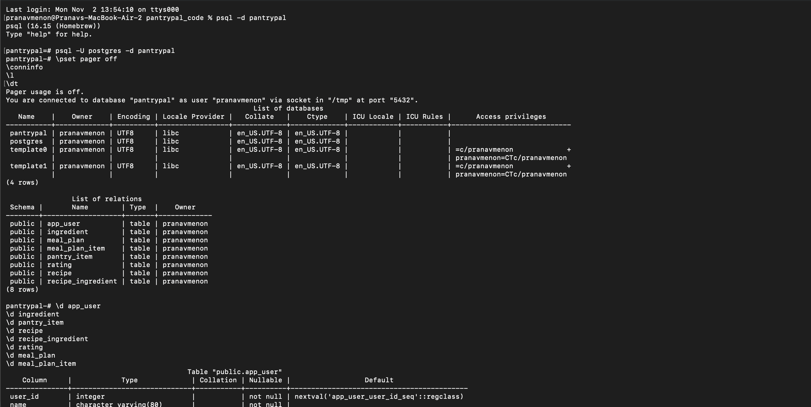

Shows a connection to pantrypal and all eight relational tables.

### Figure 2 — Ingredient catalogue

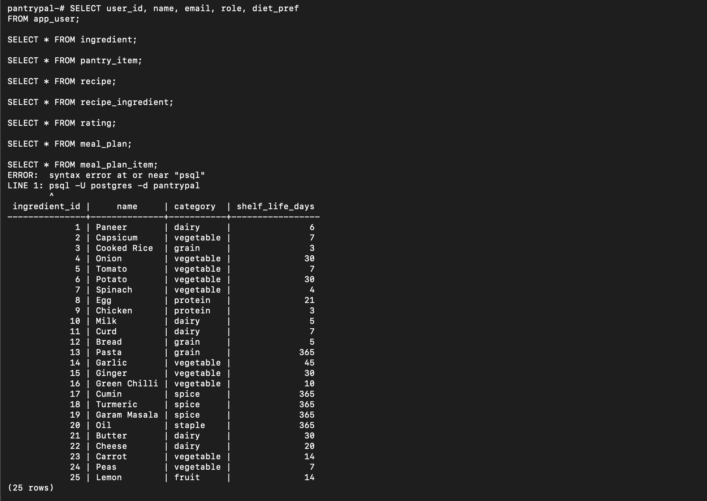

Shows 25 ingredients with categories and shelf lives. The earlier syntax error comes from entering a shell command inside psql; it is not a successful user-table query.

### Figure 3 — Ranking function results for two users

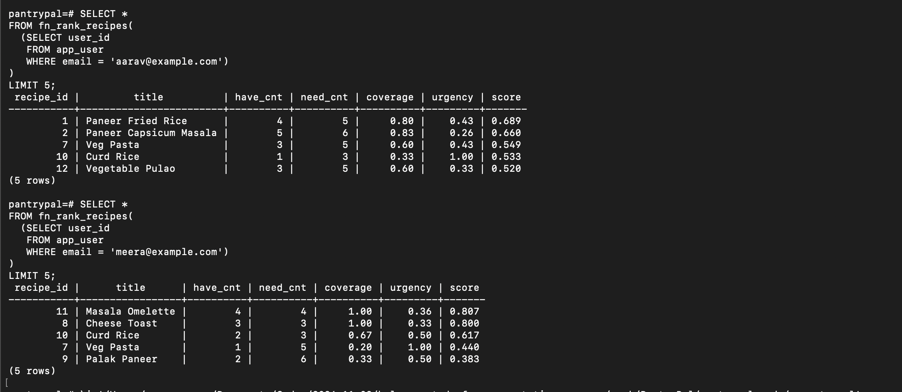

Aarav’s top result is Paneer Fried Rice at 0.689; Meera’s is Masala Omelette at 0.807. Different valid pantry matches and expiry values produce different rankings.

### Figure 4 — Meal plan constraints and trigger

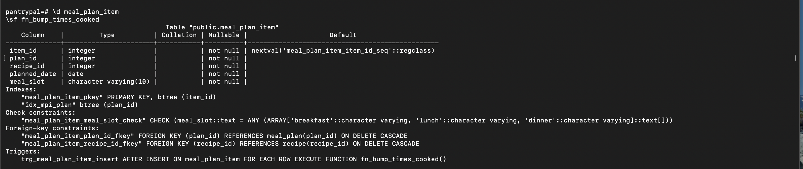

Shows primary and foreign keys, the meal-slot CHECK, an index and the AFTER INSERT trigger. This proves the trigger is installed; it does not show a before-and-after insert test.

### Figure 5 — PostgreSQL indexes

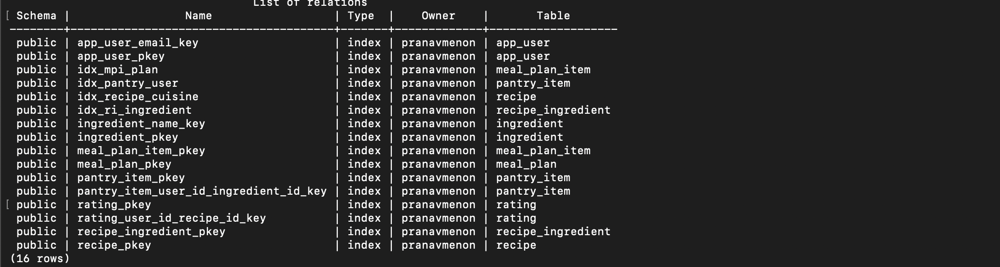

Shows 16 indexes in total, including automatically created primary/unique indexes and four explicitly created lookup indexes.

### Figure 6 — Cook tonight recommendations

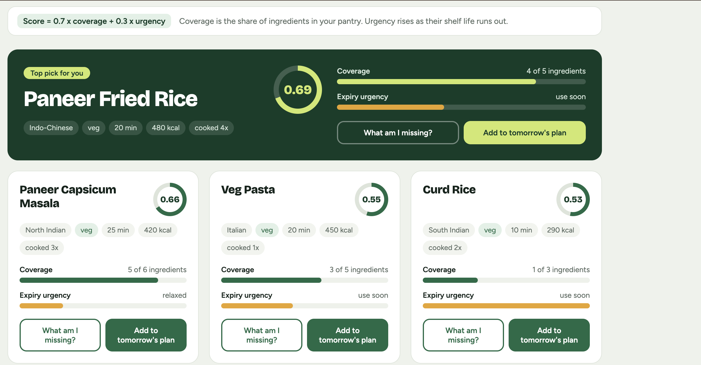

Shows recipe scores, matched ingredient counts, expiry urgency and the missing-ingredient and meal-plan buttons. The top card rounds the SQL score 0.689 to 0.69.

### Figure 7 — Pantry expiry groups

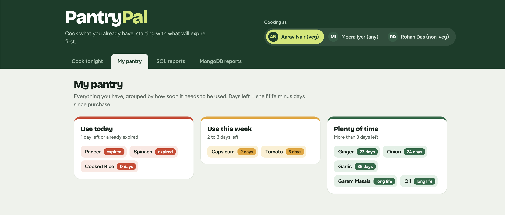

Shows expired paneer and spinach, cooked rice at zero days, and other ingredients grouped by days remaining. Expired items appear in the pantry screen but are excluded from recipe matching.

### Figure 8 — SQL reports in the application

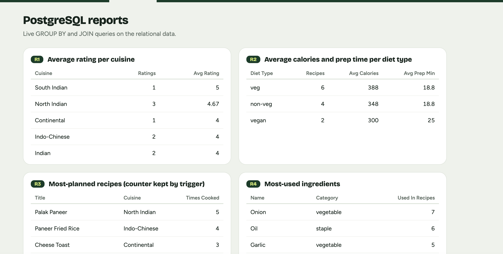

Shows R1 and R2 and the upper portions of R3 and R4. The code contains six reports; this screenshot does not display R5 or R6.

### Figure 9 — MongoDB reports in the application

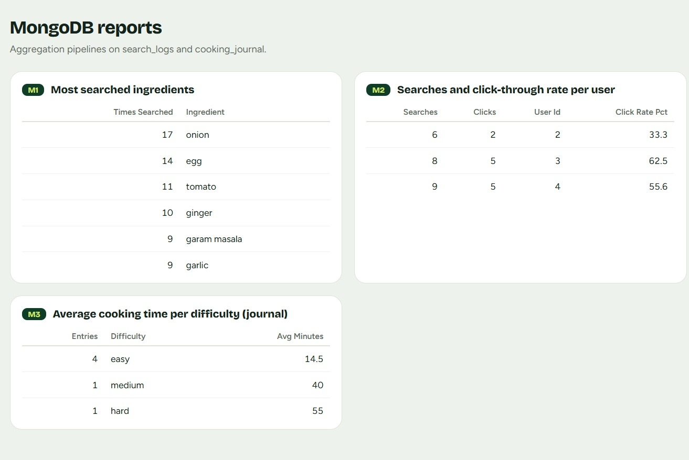

Shows all three web MongoDB reports. Onion appears 17 times. User 3 has 8 searches and 5 recorded selections, giving 62.5 percent. Easy journal entries average 14.5 minutes.

### Figure 10 — MongoDB database collections and search documents

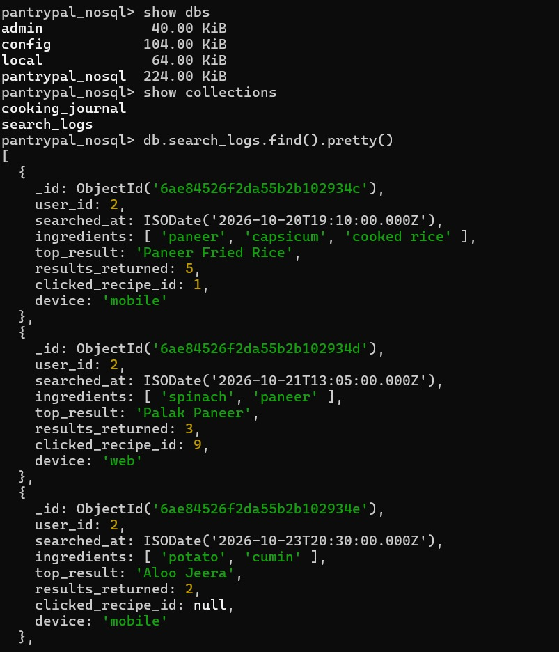

Shows pantrypal_nosql, its two collections and search documents with arrays, dates and clicked_recipe_id fields.

### Figure 11 — Additional MongoDB search documents

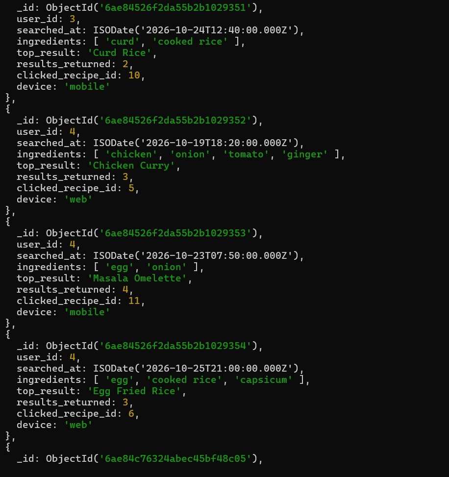

Shows user and recipe IDs linking search history to relational records, and variable ingredient arrays.

### Figure 12 — MongoDB aggregation command and results

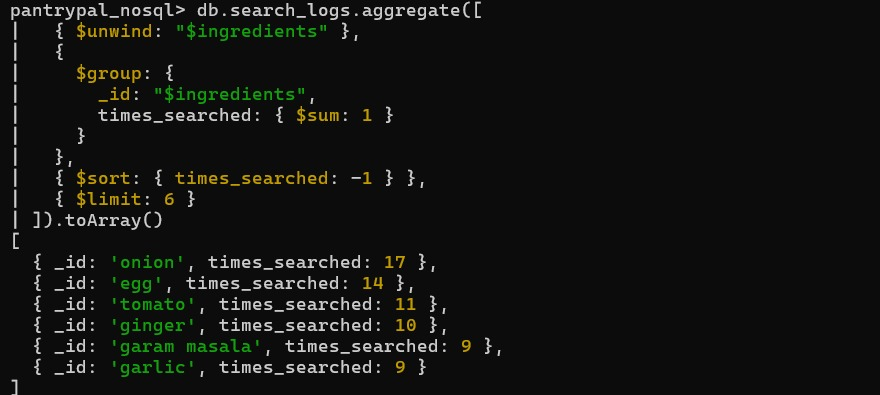

Shows an executed unwind, group, sort and limit pipeline. Results include onion 17, egg 14 and tomato 11.

### Figure 13 — Current sign-in page

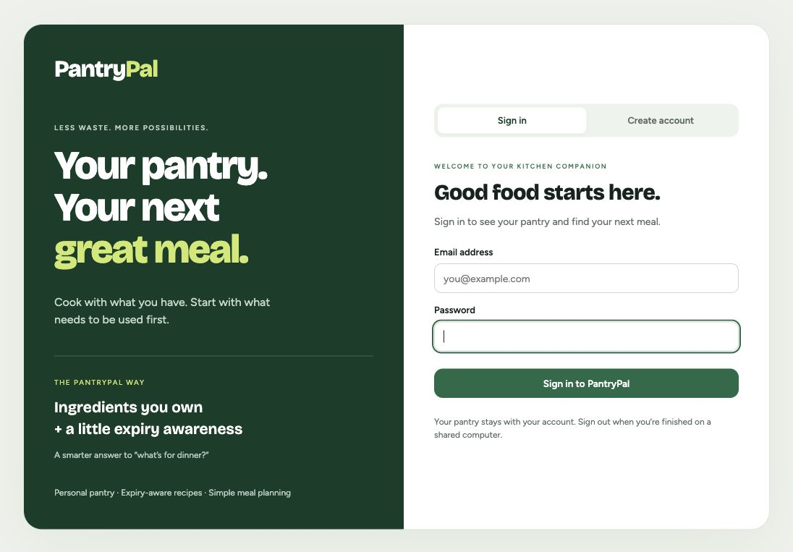

The authentication entry page replaces the old demo selector. API middleware verifies the signed-in session before returning private data.

### Figure 14 — Current account registration

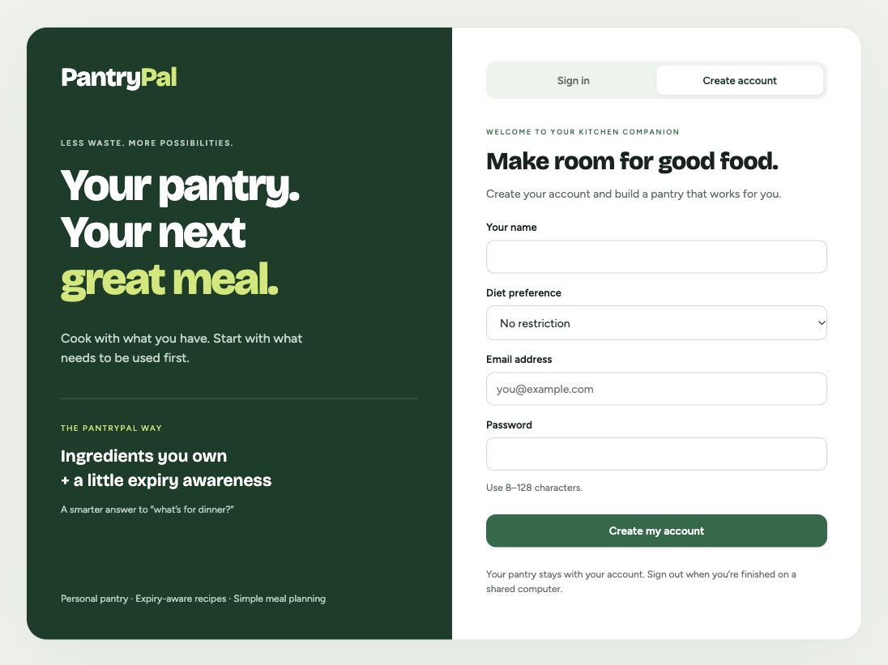

Registration takes a name, email, diet preference and password. It creates a regular user, default weekly plan and session in one transaction.

### Figure 15 — Current authenticated recipe recommendations

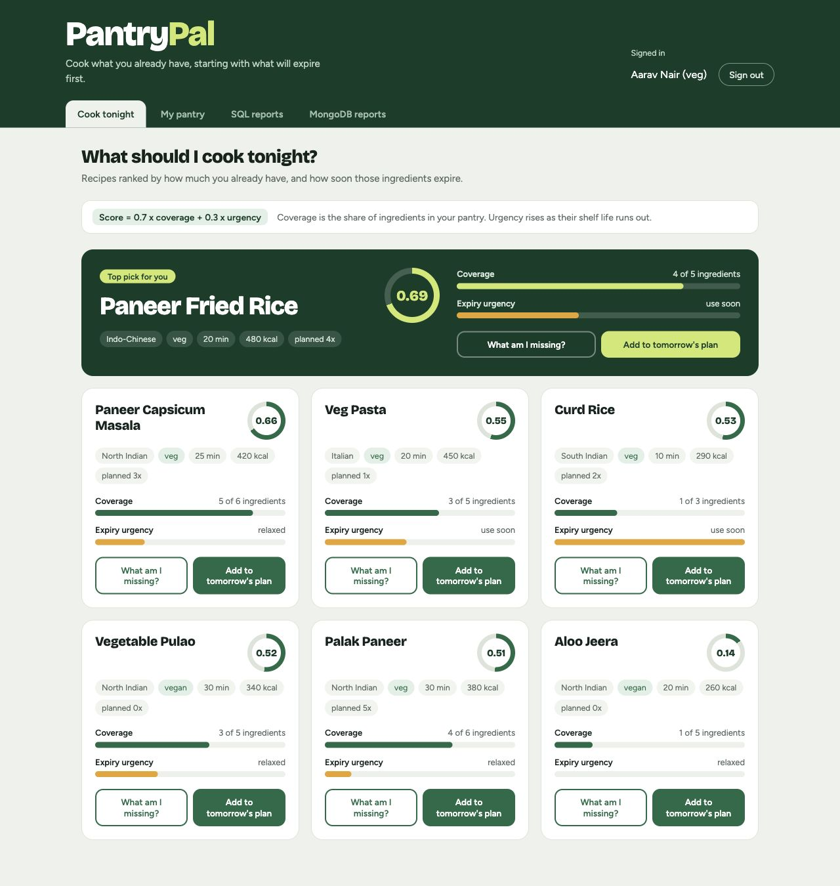

The header identifies the signed-in account and provides Sign out. Recipe cards label the counter as planned. User ownership is no longer selected by a browser ID.

### Figure 16 — Current pantry form and expiry groups

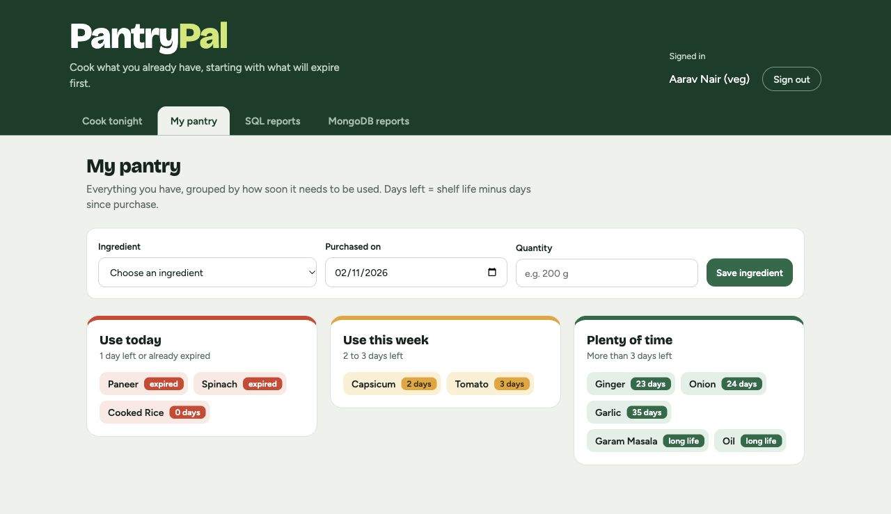

The signed-in user can add or update ingredients with purchase dates and quantities. Existing pantry information is preserved by the authentication migration.

### 8.1 Evidence still to add

- An actual VS Code screenshot of application source. This report contains source code blocks and an executed MongoDB pipeline screenshot, but no supplied IDE screenshot.
- A meal-plan insert with visible before/after counter values or its confirmation toast. The installed trigger is already shown.
- The missing-ingredient list after clicking its button, and optionally the remaining SQL report rows R5/R6.

### 8.2 Suggested demonstration order

1. Show all nine tables and explain the eight business entities plus authentication sessions.
2. Sign in; to compare accounts, sign out and sign in as the other user.
3. Show `fn_rank_recipes` results for Aarav and Meera.
4. Explain the `need` and `have` CTEs, expiry view and score formula.
5. Show the recommendation cards, pantry expiry and missing-ingredient button.
6. Insert a meal entry to demonstrate the trigger and transaction.
7. Show SQL report summaries, MongoDB collections and the aggregation pipeline.

## 9. Evaluation Rubrics — Completion Status

Status reflects the code and supplied screenshot evidence. Official grading weights were not provided. Historical screenshots are user-provided demonstration evidence. Authentication and authorization checks run in isolated databases with `npm test`; current browser screenshots verify the updated flow.

| Requirement | Status | Evidence or remaining action |
| --- | --- | --- |
| Project title | Complete | Section 1. |
| Student SRNs and names | Complete | Section 2. |
| Abstract | Complete | Section 3. |
| Technology stack | Complete | Section 4 documents the implemented stack. |
| Minimum five relational tables | Implemented | Nine tables: eight business entities and app_session; current standard ER diagrams above. Figure 1 is historical. |
| SQL database commands | Implemented and documented | Setup, inspection, table data and all six report queries. |
| More than four database feature use cases | Documented | Eleven features in Section 5.2, with actual use cases and code/examples. |
| Trigger | Implemented and installed | Figure 4 shows its definition; before/after insert capture remains to add. |
| View, CTEs and stored function | Implemented | SQL definitions/excerpts and ranking results in Figure 3; pantry UI in Figure 7. |
| Transactions, joins and constraints | Implemented | Schema and API code; constraints visible in Figure 4. |
| Indexes | Implemented and shown | Figure 5 shows the historical 16 indexes; authentication adds five session/email indexes. |
| NoSQL database commands | Implemented and demonstrated | MongoDB collections, documents and pipeline results in Figures 10–12. |
| Reports | Implemented with partial/full UI evidence | Six SQL reports in code, R1–R4 partly shown; M1–M3 fully shown. M4–M6 are script reports. |
| Novelty | Implemented and demonstrated | Expiry-aware rankings differ between users; Figures 3, 6 and 7. |
| Next.js project tree | Requirement unresolved | Actual code uses Express. Resolve required framework before final submission. |
| Authentication | Implemented and tested | Register, sign in, sign out, session expiry and ownership checks; current screenshots in Section 8. |
| Standard ER notation | Updated | Chen conceptual and complete Crow’s Foot logical diagrams with editable sources. |
| Application screenshots | Included | Historical sample use plus current authenticated UI screenshots in Section 8. |
| Application code screenshot | Partially covered | Executed Mongo pipeline image and source blocks included; IDE screenshot pending. |
| Markdown report | Created | This `.md` file and its linked image assets. |
| GitHub repository link | Provided | https://github.com/pranav6126/DBMS-Project-PantryPal |

### 9.1 GitHub Repository Link

**Repository URL: https://github.com/pranav6126/DBMS-Project-PantryPal**

The repository contains the application source, authentication modules, migration, tests, diagram generator, README setup steps, this report and `PantryPal_Report_Assets/`. Exclude `node_modules`, credentials and local configuration files containing secrets. Keep the report and asset folder together so relative image links work on GitHub.

### 9.2 Current implementation limits

- Authentication uses salted password hashes and expiring server-side sessions. Password reset, email verification and a distributed rate limiter are not implemented.
- The UI supports adding/updating pantry ingredients but does not include journal entry editing.
- Expiry is an estimate from catalogue shelf life and purchase date.
- Ingredient quantity is text and is not checked for sufficiency.
- Both ranking and missing-ingredient checks exclude expired stock; quantity sufficiency is not calculated.
- The planning counter increases on insert and does not represent confirmed meals cooked.
- MongoDB writes are optional and separate from the PostgreSQL transaction.
- Next.js is not implemented in the supplied project.

### 9.3 Submission checklist

- [x] Add names, SRNs, abstract and implemented stack.
- [x] Include standard Chen and Crow’s Foot ER diagrams, session table and database explanations.
- [x] Implement registration, sign-in, logout and session-scoped APIs.
- [x] Explain more than four database feature use cases.
- [x] Include supplied PostgreSQL, UI and MongoDB screenshots.
- [ ] Add an IDE code screenshot and before/after trigger evidence; source excerpts and installed-trigger evidence are already included.
- [ ] Resolve the Next.js requirement.
- [x] Include the GitHub repository URL.

### Source material

- Supplied `PantryPal_App_new_UI (1).zip`: `public/index.html`, `server.js`, `package.json`, README and database scripts.
- Supplied ER diagram and project status PDF. Actual code takes priority where the earlier status PDF describes unimplemented screens.
- Twelve original supplied screenshots plus four current browser captures showing sign-in, registration, authenticated recommendations and the pantry form.
