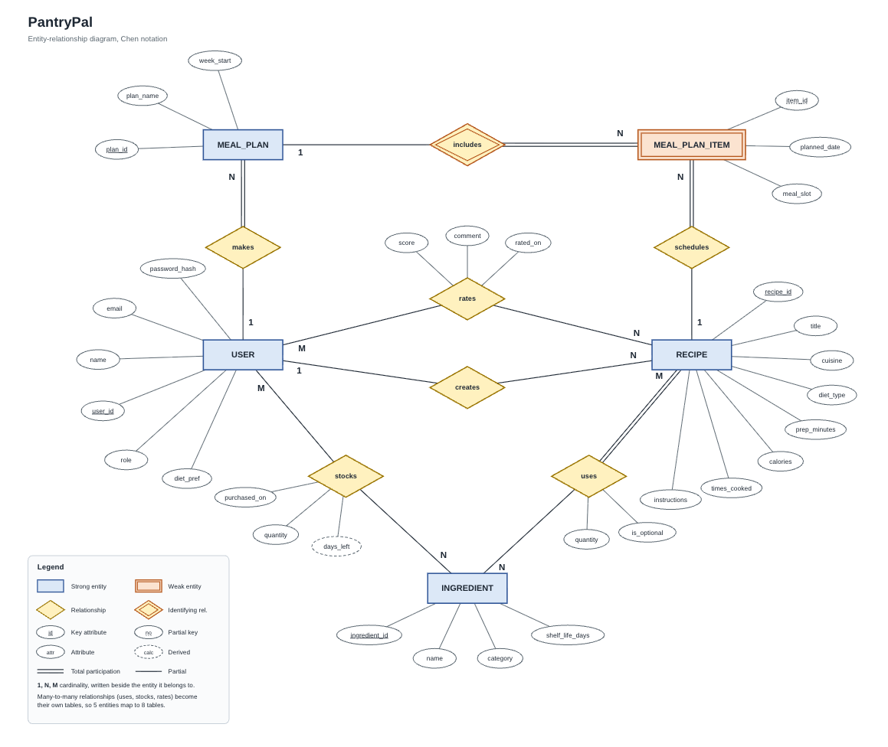

# PantryPal database design

## Approved presentation image

This image was supplied by the team and is preserved without alteration. It is the only ER diagram in the repository. Rectangles represent entities, diamonds relationships, ellipses attributes and solid underlines entity keys. A double rectangle denotes the weak MEAL_PLAN_ITEM entity, a double diamond the identifying includes relationship, double connections total participation, and a dashed ellipse derived days_left. The partial key has a dashed underline.

## Mapping the conceptual model to SQL

| Conceptual entity or relationship | SQL implementation |
| --- | --- |
| USER | app_user |
| RECIPE | recipe |
| INGREDIENT | ingredient |
| MEAL_PLAN | meal_plan |
| MEAL_PLAN_ITEM | meal_plan_item |
| USER stocks INGREDIENT | pantry_item, with purchased_on and quantity; days_left is computed by v_pantry_expiry |
| RECIPE uses INGREDIENT | recipe_ingredient, with quantity and is_optional |
| USER rates RECIPE | rating, with score, comment and rated_on |
| Authentication outside the business diagram | app_session |

The conceptual image therefore maps to eight business tables plus one session table. The schema also includes defaults, uniqueness rules and nullable recipe.created_by; it remains the implementation authority. The complete machine-readable SQL model is in [schema-model.json](schema-model.json).

## Weak entity and current key

The supplied diagram uses item_id as a partial key of a weak MEAL_PLAN_ITEM owned by MEAL_PLAN. Such a conceptual identity is (plan_id, item_id). The current SQL implementation instead uses globally unique item_id SERIAL PRIMARY KEY, with plan_id as a required cascading foreign key. The required plan dependency exists, but the exact weak composite key is not implemented. This image replacement does not migrate existing keys or alter application behavior.

## Authentication migration

The existing additive migration pantrypal_code/migrations/001_auth.sql widens password_hash to VARCHAR(255), adds app_session and case-insensitive email uniqueness, without dropping business records. Local demo passwords are provisioned with npm run setup:demo and excluded from Git.

## Image maintenance

The image is manually supplied rather than generated. npm run diagrams checks it exists and has a PNG signature; it cannot overwrite it. To replace the image again, update PantryPal_Report_Assets/er-diagram.png and the description if its model changes.
